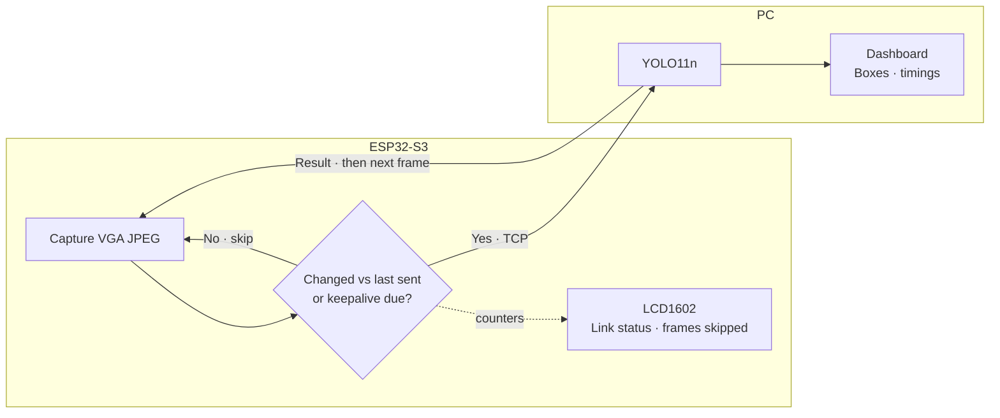

# Edge-Cam

ESP32-S3 camera that decides on-device which frames are worth sending.  
A PC runs YOLO only on those frames and returns the result over the same link.



## Layout

| Path | What |
| --- | --- |
| `firmware/` | ESP-IDF v6.1 project for ESP32-S3 (Freenove WROOM camera board) |
| `firmware/main/gate.c` | motion gate: 1/8 JPEG decode + frame difference |
| `firmware/main/stream.c` | capture loop, TCP server, one frame in flight at a time |
| `firmware/main/protocol.h` | wire format, mirrored by `host/edgecam/protocol.py` |
| `host/` | Python client: YOLO inference + local dashboard |

## Run

Firmware:

```sh
cd firmware
cp secrets.defaults.example secrets.defaults   # fill in a 2.4 GHz Wi-Fi
idf.py set-target esp32s3 build flash monitor
```

The LCD shows the board IP once Wi-Fi is up.

Host:

```sh
cd host
uv run python -m edgecam --board <board-ip>
```

Dashboard at http://127.0.0.1:8000.

Gate threshold, keepalive interval and TCP port are in `idf.py menuconfig` → *Edge camera*.
